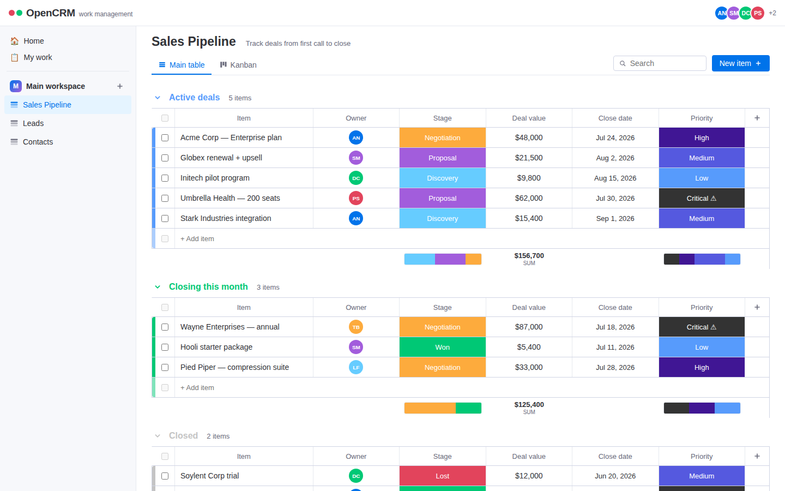

# OpenCRM

An open-source CRM with a monday.com-style board interface. Built with React and Node.js.




## Features

- **Boards** — organize your pipeline into boards (Sales Pipeline, Leads, Contacts out of the box)
- **Groups & items** — colored, collapsible groups of rows, just like monday.com
- **Subitems** — expand any item into a nested checklist with its own columns
- **Column types** — status, priority, dropdown, text, long text, numbers, date, timeline, people, checkbox, rating, email, phone, link, and files. Edit labels, colors, and units per column
- **Views** — Main table, Kanban, Calendar, Timeline (Gantt), and a Dashboard with KPI tiles and charts
- **Filtering, sorting & saved views** — build filter conditions, sort by any column, and save named views
- **Collaboration** — an item panel with an updates feed, @mentions, a per-item activity log, and file links
- **Notifications** — a bell in the top bar, driven by mentions and automations (switch the acting user to see per-user inboxes)
- **Automations** — rules like _When Status becomes Won, notify the owner / set a column / move to a group_
- **Inline editing** — click any cell to edit; status, people, dropdown, and date cells open pickers
- **Group summaries** — status distribution strips and number-column sums per group
- **Search** — filter items across the current board
- **Persistence** — a JSON file out of the box, or Google Firestore when configured (see [Data storage](#data-storage))

## Stack

| Layer    | Tech                              |
| -------- | --------------------------------- |
| Frontend | React 18 + Vite                   |
| Backend  | Node.js + Express                 |
| Storage  | JSON file (default) or Google Firestore |

## Getting started

```bash
npm install
npm run dev
```

- Client (Vite dev server): http://localhost:5173
- API: http://localhost:4000

The client dev server proxies `/api/*` to the API.

### Production

```bash
npm run build   # builds the client into client/dist
npm start       # serves API + built client on http://localhost:4000
```

The database seeds itself with demo data on first run. Delete `server/data/db.json` to reset.

### Desktop app (Electron)

```bash
npm run electron       # builds the client, then opens OpenCRM in a desktop window
npm run electron:dev   # desktop window on the Vite dev server, with hot reload
```

The desktop app runs the API in-process on a free local port. The Electron
entry point is `electron/main.cjs`.

To build a Windows installer:

```bash
npm run dist           # -> release/OpenCRM Setup <version>.exe
```

The installed app keeps its data and config in `%APPDATA%\OpenCRM`
(`data\db.json`, and an optional `.env` there for Firestore / AI keys), not in
the install folder. Local data, `.env` and service-account keys are never
bundled into the installer.

## Data storage

OpenCRM persists through a swappable backend ([`server/store.js`](server/store.js)). On boot it prints which one is active (`Storage: …`).

- **JSON file (default)** — no setup. Everything is written to `server/data/db.json`.
- **Google Firestore** — used automatically once credentials are present.

### Configuring Firestore

1. In the [Firebase console](https://console.firebase.google.com/), open your project → **Project settings → Service accounts → Generate new private key**. This downloads a JSON key file.
2. Put the key where the server can find it. Either:
   - save it as **`server/serviceAccount.json`** (auto-detected, already git-ignored), or
   - save it anywhere and point to it from `.env`:
     ```bash
     cp .env.example .env
     # then in .env:
     FIREBASE_SERVICE_ACCOUNT=/absolute/or/relative/path/to/serviceAccount.json
     ```
   - or use application-default credentials instead: set `GOOGLE_APPLICATION_CREDENTIALS`.
3. Start the server. You should see `Storage: Firestore (project …)`. On first run it seeds demo data into the `boards` collection plus `meta/users` and `meta/notifications` documents.

The service-account key is a **secret** — it is listed in `.gitignore` and must never be committed. See [`.env.example`](.env.example) for all options (`FIRESTORE_PROJECT_ID`, `FIRESTORE_COLLECTION`, …).

> Each board is stored as a single Firestore document, which keeps the code simple but means one board must stay under Firestore's 1 MiB document limit (thousands of items — fine for CRM use).

## Team chat & AI assistant

The **Chat** page (sidebar) has group channels, a broadcast channel, DMs, and an AI channel. Messages support photos, docs, videos, voice notes, video notes, task cards, quick replies, and `@mentions` (which create notifications).

Ask the AI about your work in the AI channel or with `@ai` in any channel — _"what's overdue?"_, _"what's assigned to me?"_, _"how many deals are in negotiation?"_, _"total pipeline value?"_. It reads your boards directly.

- **No API key:** a built-in engine answers the common task questions deterministically.
- **Google Gemini:** set `GEMINI_API_KEY` ([get one here](https://aistudio.google.com/apikey)); optionally `GEMINI_MODEL` (default `gemini-2.0-flash`).
- **Anthropic Claude:** set `ANTHROPIC_API_KEY` (optionally `ANTHROPIC_MODEL`).

The provider is auto-detected (Gemini preferred); force one with `AI_PROVIDER=gemini|claude|local`. The active provider is printed at startup. See [`.env.example`](.env.example).

## API overview

| Method | Path                                     | Purpose                    |
| ------ | ---------------------------------------- | -------------------------- |
| GET    | `/api/boards`                            | List boards                |
| POST   | `/api/boards`                            | Create board               |
| GET    | `/api/boards/:id`                        | Full board (groups, items) |
| PATCH  | `/api/boards/:id`                        | Rename board               |
| DELETE | `/api/boards/:id`                        | Delete board               |
| POST   | `/api/boards/:id/groups`                 | Add group                  |
| PATCH  | `/api/boards/:id/groups/:gid`            | Rename/collapse group      |
| POST   | `/api/boards/:id/groups/:gid/items`      | Add item                   |
| PATCH  | `/api/boards/:id/items/:iid`             | Rename item / set values   |
| POST   | `/api/boards/:id/items/:iid/move`        | Move item between groups   |
| POST   | `/api/boards/:id/columns`                | Add column                 |

## License

[AGPL-3.0](LICENSE)

## Author

Built by **Ahsan Nawazish** — AI / ML Engineer.
[Portfolio](https://ahsan.live) · [LinkedIn](https://linkedin.com/in/anawazish) · [GitHub](https://github.com/innoce9t)
